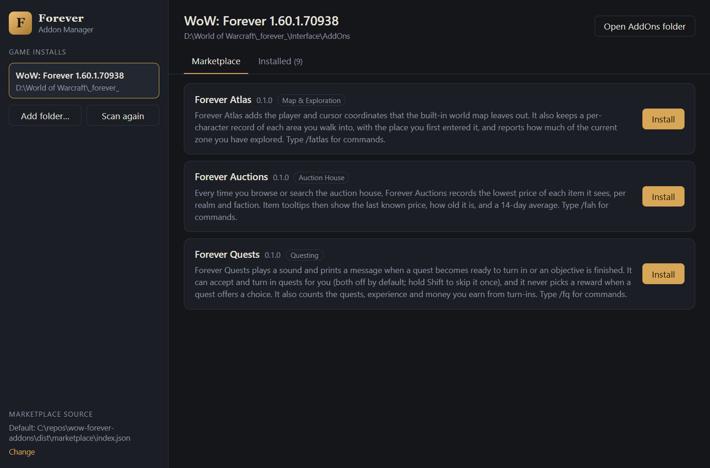

# WoW: Forever Addons

Addons for **World of Warcraft: Forever**, and the **Forever Addon Manager**, a desktop app that finds your game install and installs or updates the addons from this repository.



## Addons

Addons are written in Lua. The game loads the `.toc` and `.lua` files of each addon folder and nothing else.

| Addon | Folder | What it does | Command |
|---|---|---|---|
| Forever Auctions | [addons/ForeverAuctions](addons/ForeverAuctions) | Records auction house prices as you browse, or all at once with the full scan button. Shows auction, vendor and stack values in item tooltips, suggests an undercut price when you post, and tells you when your auctions are no longer the lowest. Has a shopping list of saved searches beside the auction house window, price alerts, a searchable price window that marks deals, a ledger of your sales and purchases, and the value of your bags | `/fah` |
| Forever Atlas | [addons/ForeverAtlas](addons/ForeverAtlas) | Shows coordinates on the world map and on screen. Sets waypoints with a direction arrow (`/way 45.2 61.8`), keeps your own map notes (Alt-click the map), and pins each area a character has visited | `/fatlas` |
| Forever Bags | [addons/ForeverBags](addons/ForeverBags) | Shows all your bags in one window, by category or in the order of the bags, with a search box. Remembers the bags, the bank and the gold of each of your characters, lists them together in one searchable window, and adds to each item tooltip how many you own and which character has them | `/fbags` |
| Forever Compass | [addons/ForeverCompass](addons/ForeverCompass) | Puts a compass bar across the top of the screen, with N, NE, E, SE, S, SW, W and NW, that scrolls through 360 degrees as you turn. Up to four trackers each mark the nearest thing of a kind you choose on the bar, with its name and distance: quest objectives, turn-ins, quest givers, rare enemies, flight masters, party members and more. Vendors, repairers, trainers, bankers, auctioneers and mailboxes are learned as you visit them | `/fcompass` |
| Forever Meter | [addons/ForeverMeter](addons/ForeverMeter) | A damage and healing meter for solo play, parties and raids. A bar for each player with DPS, damage, healing, absorbs, interrupts, dispels, damage taken or deaths, with its own number of bars for each kind of group. Shows your own DPS on screen, the current fight, the whole session or an earlier fight, the spells of a player, and reports the list to chat | `/fmeter` |
| Forever Quests | [addons/ForeverQuests](addons/ForeverQuests) | Tells you when a quest is ready to turn in, and can accept and turn in quests for you (off by default). Can show only the quests of your current zone in the quest log and the tracker (`/fq zone`). Puts a quest that makes progress at the top of its zone in the quest log, with a glow for a few seconds (`/fq pop`), and can sort the quests of each zone by name (`/fq sortname`). Shows the vendor price of each reward choice, shares objective progress with party members, and counts quest experience | `/fq` |

Each addon has a full settings page in the game's Options window, under AddOns. This is a requirement for every addon in the repository, and the lint checks it.

## Repository layout

Everything outside the addons is Rust, in one Cargo workspace.

| Path | Language | Contents |
|---|---|---|
| `addons/<Name>/` | Lua | One folder for each addon: `<Name>.toc`, the Lua files, and `addon.json` with the marketplace text |
| `client/core/` | Rust | Install detection, the marketplace reader and the install logic, with the `wfam` command line |
| `client/src-tauri/` | Rust | The desktop app (Tauri 2). It wraps `client/core` in commands for the window |
| `client/ui/` | HTML, CSS, JavaScript | The window of the desktop app, which Tauri shows in a webview. Plain files, no build step |
| `tools/` | Rust | Repository tools: addon lint, addon tests, marketplace build and the icon source |
| `tools/harness/` | Lua | The stand-in for the game client that the addon tests run in, and one scenario with checks for each addon |
| `tools/api/` | JSON | The API of the game client: functions, widget methods, events and their arguments, from Blizzard's API documentation |
| `.cargo/config.toml` | | Short names for the commands below |
| `.github/workflows/` | | Tests on each push, and the marketplace publish |

## Requirements

- [Rust](https://rustup.rs) (stable).
- On Windows: the Visual Studio 2022 Build Tools with the "Desktop development with C++" workload. WebView2 is part of Windows 11.
- For the desktop app, the Tauri command line:

```bash
cargo install tauri-cli --version "^2" --locked
```

## Commands

Run these from any folder of the repository.

| Command | What it does |
|---|---|
| `cargo dev lint` | Checks the TOC, `addon.json`, the file list, the settings page and the Lua syntax of each addon |
| `cargo dev test` | Loads each addon in a stand-in for the game client and uses everything in it: each settings page, slash command, frame and event, out of a fight and in a fight. `--coverage` lists the lines that did not run |
| `cargo dev conformance` | Checks each name of the game's API that the addons use against the API of this client, on every line, without running them |
| `cargo dev api-snapshot <folder> --check`, `cargo dev ui-names <folder> --check` | Compare the API files in `tools/api/` with Blizzard's UI source. CI runs both at the pinned commit, and each day against the newest one |
| `cargo dev marketplace` | Writes one ZIP for each addon and an `index.json` to `dist/marketplace/` |
| `cargo dev icon <out.png>` | Draws the source image of the app icon |
| `cargo dev track-icon` | Draws the tracking and the compass symbol of Forever Quests as textures of the game (`Media/Track.tga`, `Media/Compass.tga`) |
| `cargo wfam <command>` | The addon manager on the command line: `detect`, `list`, `market`, `install <id>`, `update`, `uninstall <id>` |
| `cargo link-addons` | Links each addon folder into the game, so the game loads your working copy |
| `cargo unlink-addons` | Removes those links |
| `cargo test -p wfam-core -p wfam-dev` | Runs the tests of the manager core and the tools |
| `cargo tauri dev` | Builds and starts the desktop app in development mode |
| `cargo tauri build` | Makes a release build and a Windows installer in `target/release/bundle/` |

## Use the addon manager

```bash
cargo dev marketplace
```

```bash
cargo tauri dev
```

The manager finds installs from the Battle.net product database, the registry, and the usual folders on each drive. If it finds nothing, use **Add folder…** and select your World of Warcraft folder. It installs only into the `_forever_` flavor.

- An addon that the manager installed has a `.wfam.json` file in its folder. The manager updates these without a question.
- **Update automatically** is on by default. The manager looks for updates when it starts and every 30 minutes while it is open, and installs each update of the addons that it installed, in every game install. It installs nothing new. Turn it off under "Updates" in the window.
- An addon that you installed by hand is not changed unless you confirm it.
- A development link (see below) is never changed.
- Each package is checked against the SHA-256 in the marketplace index before it is installed.

The same operations are available on the command line:

```bash
cargo wfam detect
```

```bash
cargo wfam market
```

```bash
cargo wfam install forever-quests
```

## The marketplace

`cargo dev marketplace` writes one ZIP for each addon and an `index.json` to `dist/marketplace/`. The publish workflow uploads these files to the GitHub release with the tag `marketplace`. The manager reads the index from that release:

`https://github.com/ChristianPresley/wow-forever-addons/releases/download/marketplace/index.json`

The publish workflow runs the lint, the conformance check and the addon tests first, and uploads nothing if one of them fails. The manager finds an update by the version of an addon. So the workflow also fails if the files of an addon changed and its version did not: raise `## Version` in the `.toc` file with each change to an addon. `cargo dev marketplace --published <folder>` makes this check against a copy of the published marketplace in `<folder>`.

A development build of the manager uses the local `dist/marketplace/index.json` when that file exists. You can also set a different source in the app, or with the `WFAM_SOURCE` environment variable.

## Develop an addon

See [docs/addon-development.md](docs/addon-development.md) for the facts about the Forever client and the steps to add an addon.

```bash
cargo link-addons
```

This command links each addon folder into `_forever_\Interface\AddOns`. Type `/reload` in the game after a change. `cargo unlink-addons` removes the links.

Not affiliated with Blizzard Entertainment. World of Warcraft is a trademark of Blizzard Entertainment, Inc.
